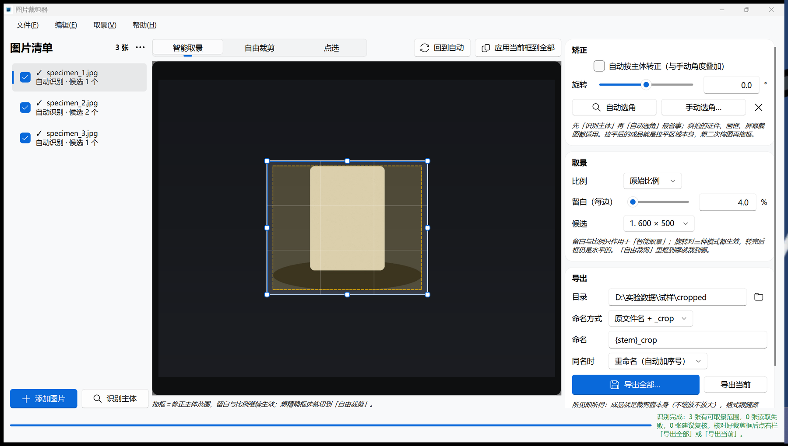
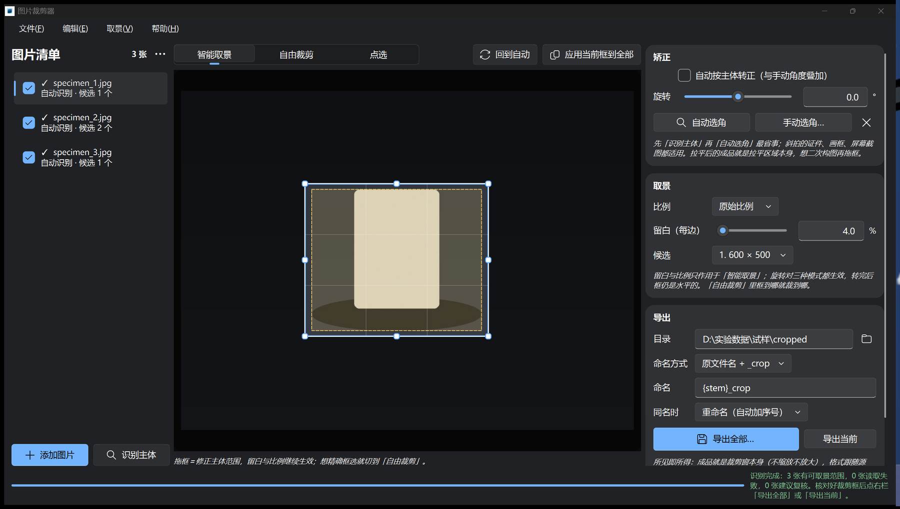

# 图片裁剪器 —— 自动找出主体，专注把照片裁正、裁好

[](https://github.com/Tumu-Zhang/imgcrop/actions/workflows/ci.yml)
[](LICENSE)


把一批照片裁成「主体大小一致、留白一致、构图统一」的成品：
拖进去，程序用本地小模型找出每张图里的主体，按主体归一化取景，1:1 直接输出。
**原图一个字节都不动。**

*Batch-crop research photos to a uniform framing — local ISNet + EfficientSAM segmentation,
pure local inference, GUI + CLI, Windows.*

自动结果不对时，点一下物体（EfficientSAM 点选）或直接拖框即可修正 ——
人工兜底和全自动走的是同一条裁剪链路，所以"预览里看到的"和"导出的"必然一致。

**矫正三件套**（v1.1.0）：

- **透视拉平**：拖四个角点，把斜拍的证件、画框、屏幕截图拉成正视矩形；
- **自动转正**：最小面积矩形拟合估角，证件/文档类比传统 PCA 长轴更稳；
- **手动旋转 ±180°**：滑块粗调 + 输入框键入 0.1° 精调，与自动转正叠加。

**输出所见即所得**（v1.1.0 瘦身定案）：成品像素 = 裁剪窗原始像素，
不缩放、不放大；输出格式跟随源图（PNG 保透明、TIFF→PNG、其余 JPG），
DPI 元数据跟随源图（缺省 300）。**不再需要填尺寸、DPI、格式** ——
右栏只剩「矫正 / 取景 / 导出」三张卡，裁到哪就输出哪。

全过程是纯几何与编码变换（主体检测 + 取景 + 编码 + 元数据写入），
不做任何 AI 重绘或图像生成。

**👉 [下载 Windows 绿色版（免安装，解压即用）](https://github.com/Tumu-Zhang/imgcrop/releases/latest) 👈**

| 浅色主题 | 深色主题 |
|---|---|
|  |  |

---

## 快速开始

### 方式一：下载绿色版（推荐，不需要装 Python）

到 [**Releases**](https://github.com/Tumu-Zhang/imgcrop/releases/latest) 下载
`imgcrop-v*-win64.zip`，解压后双击文件夹里的 **`图片裁剪器.exe`** 即可 ——
不用装 Python，不用编译，解压就能用。

这是一个绿色软件，**两个分割模型（约 90 MB）已经内置在包里**，所以拷到任何
Windows 电脑上都能直接用，不需要联网、不需要另外下模型。

> 要一起带走的是 `图片裁剪器.exe` 和同级的 `_internal\` 文件夹，两者缺一不可
> （后者是运行库与模型）。想放桌面的话，右键 exe → 发送到 → 桌面快捷方式即可。
> 也可以把图片／文件夹直接拖到 exe 图标上，启动后它们已在清单里。
> 首次运行若被 SmartScreen 拦截：点「更多信息 → 仍要运行」（程序未做代码签名）。

### 方式二：从源码运行（需要 Python 3.10+）

```bash
pip install -r requirements.txt

# 图形界面
python main.py
```

源码方式不会替你装依赖或取模型：先 `pip install -r requirements.txt`，模型没到位时用
`python tools/fetch_models.py`（会告诉你缺什么，按镜像站下载或离线导入）。

### 确认它能用：自检

打包版和源码版都支持一次真实自检 —— 它会合成测试图、走完整裁剪链路、读回校验
尺寸与 DPI，并确认模型与 onnxruntime 真的可用：

```bash
图片裁剪器.exe --selftest
```

---

## 界面怎么用

界面按 Google（Material）风格校准（强调色：浅 #0969da / 深 #58a6ff），
浅色／深色跟随系统，清单带 48px 缩略图。

1. **把图片拖进窗口**（文件夹也行，会递归展开；非图片文件会被忽略并说明原因），
   或点左下角**「添加图片」**
2. 加进来的图会自动**识别主体**，并在清单里标出状态：`✓` 正常、`?` 建议复核、`✗` 读不出来
3. 需要矫正就先用右栏「矫正」卡（拉平/转正/旋转），再在中间预览里核对裁剪框
4. 点**「导出全部…」**

### 矫正卡（v1.1.0 新增）

| 功能 | 用法 |
|---|---|
| **自动转正** | 勾选后按主体掩膜的最小面积矩形估计倾斜并自动转正（主体朝向不明确时会提示而不乱转） |
| **手动旋转** | ±180° 滑块 + 可键入 0.1°；画面实时跟着转，框照旧水平，成品永远是正的 |
| **透视拉平** | 点「透视拉平…」→ 画布上拖四个角点围住要拉平的区域 → 松手即拉平；拉平后可继续旋转与取景；「撤销拉平」随时回原图 |

矫正管线 = **透视拉平 → 自动/手动旋转 → 取景**：拉平是正交前置步骤，
之后的三种取景模式照常用。注意：已拉平的图不再叠加自动转正
（掩膜坐标系对不上），识别出的主体框会自动映射到拉平图上。

### 预览与调整

取景有三种模式，在画布上方切换（快捷键 `T` 智能取景 / `F` 自由裁剪 / `P` 点选）：

| 模式 | 拖出来的框是什么 |
|---|---|
| **智能取景** | 框 = **主体范围**，成品窗由「留白」与「比例」自动算出来（批量一致靠它） |
| **自由裁剪** | 框 = **成品范围**，拖到哪就裁到哪，不再套留白与比例 |
| **点选** | 点一下用 EfficientSAM 分割出物体（点哪儿都算，拖动才是改框）；选不全时可以直接拖框补上 |

| 操作 | 做法 |
|---|---|
| 移动取景 | 在框内拖动 |
| 缩放取景 | 拖框的四角／四边 |
| 重新框一块 | 在框外拖动；**没有框时直接拖一下就能框出来**（识别失败也有救） |
| 点选主体 | 「点选」模式下在图上**点一下**要保留的物体 —— 框内框外都算点选（主体本来就在框里），拖动才是改框 |
| 排除多选的区域 | 在多余处**右键点一下**（负点，画成带斜杠的蓝点）；`Esc` 清除全部提示点 |
| 换一个候选主体 | 下拉「候选」，或直接按 `1`–`4`（候选 1 最贴合主体，往后一档比一档宽松） |
| 回到自动结果 | 按 `R`（同时把手动角度归零）（「点选」模式下双击画布不生效，避免与点选打架） |
| 把当前框套到整批 | 按 `L` 套用到全部（按比例适配每张图，**连同当前旋转角度**） |

完整快捷键速查在「帮助 → 键盘快捷键」（F1）。

拖框只会落在图像范围内（不会拖出半截框，导出时莫名多一圈补边）。

拖过框、点选过、套用过的图会标记为**人工** —— 之后重新识别不会覆盖你的改动。
在「智能取景」里拖框只是修正主体位置，**留白与比例仍然生效**；点选给出的是
**主体范围**，所以「留白」与「比例」对它同样生效（批内一致就靠这个）。要"精确到
像素、说什么就是什么"的取景，就切到「自由裁剪」。

旋转角是**每张图各自记着**的：重新识别不会把它清掉（按 `R` 才归零），
所以"逐张转正"和"整批套同一个角度"两种用法可以混着来。

### 批量任务的护栏

- **并发防护**：识别、点选、导出共用一把锁 —— 有任务在跑时其它任务入口会被拦下
  并提示，不会再出现"两个模型同时推理"的内存峰值。
- **可取消**：底部进度行旁的「取消」按钮（任务运行时才出现），识别与导出都能在
  文件边界停下，**已完成的结果保留**。
- **清空有确认**：「清空清单」会先确认（写明将丢弃识别与手动调整），误触不再全丢。

### 清单上的两个帮手

- **可疑优先**：把"没找到主体／候选太多／主体占比看着不对"的图排到最前面，
  复核时不用一张张翻。
- **包含 / 排除选中**：单张跳过（清单里会标「跳过」），导出时自然不带它。

这两个动作、加上「添加文件夹」「从清单移除」「清空清单」，都收在清单右上角的
**「⋮」**里（在清单上右键也有同一套菜单）—— 左栏只留「添加图片」和「识别主体」
这两个最常用的按钮。

### 输出参数（v1.1.0 瘦身后）

右栏三张卡：**矫正**（上文）、**取景**、**导出**。

| 参数 | 说明 |
|---|---|
| 比例 | 原始比例 / 1:1 / 4:3 / 3:2 / 16:9 / 3:4 / 2:3 / 9:16（约束取景窗形状） |
| 留白（每边） | 主体四周各留多少，默认 **4%**（主体约占画面 92%）。滑块粗调，输入框可直接键入 |
| 命名方式 | **原文件名 + _crop**（默认，`照片.png` → `照片_crop.png`）／**原文件名**／自定义模板 |
| 命名 | 选「自定义模板」时才会亮起；变量 `{stem}` = 源文件名（不含扩展名） |
| 同名时 | 自动改名（默认，不覆盖你的文件）／跳过／覆盖 |
| 目录 | 留空＝每张图自己所在目录下的 `cropped\` 子文件夹 |

**不再有的设置**（v1.1.0 删除）：输出尺寸（像素/物理）、DPI、格式、体积上限 ——
成品就是裁剪窗本身（1:1），格式跟随源图（PNG 保透明 / TIFF→PNG / 其余 JPG 95），
DPI 元数据跟随源图（缺省 300）。需要特定输出规格的场景，请用「图片转换器」做后处理。

**导出后如果整批出现多种像素尺寸**，完成面板会明确列出：成品尺寸由每张图的
取景框决定 —— 要整批一致，把各图的框框成同一个形状，或在「比例」里选固定比例。

---

## 几个需要理解的语义

### 主体归一化取景（批内一致的原理）

画面尺寸 = **主体尺寸 × (1 + 2 × 边距)**。于是同一批照片里，
主体占画面的比例、留白宽度自然一致，**与拍摄远近无关** —— 不需要预先扫描整批，
也不需要手工对齐。v1.1.0 起输出 1:1 不再重采样，"批内一致"表现为
主体占比一致，成品像素随各图的取景框走。

### 留白不够时的处理

主体贴边时，取景窗会越出原图边界 —— 这时**补背景而不是把窗缩回来**。
缩回来会破坏批内一致的主体占比；补背景只是多留一圈白。这件事会在结果里明说。

### 旋转与倾斜校正

两种角度，可以单用也可以叠加：

- **自动转正**：勾上「自动按主体转正」，用主体掩膜的**最小面积矩形**估计朝向并
  把图转正（主体朝向不明确时会提示：检测到倾斜但不自动旋转）。
- **手动角度**：矫正卡「旋转」滑块／输入框，**±180°**，画面实时跟着转。

两者叠加（"自动打底 + 手动微调"），总量会写进导出提示。**画面转、裁剪框
始终水平**，所以成品永远是正的；想看转正后的效果再摆框，就照预览里的摆。

**整批角度一致**靠「应用当前框到全部」（`L`）：它会把框**连同当前角度**一起
套到所有图 —— 同一台相机／扫描仪造成的固定偏斜，调一次就够。若每张的倾斜
各不相同，就用「自动转正」让它们各自转正。

> 转正后主体的轴对齐包围盒会略大于原框（斜着放的矩形要更大才装得下），
> 所以转正后"主体占画面比例"看着会小一点 —— 这是几何必然，不是裁歪了。

### 透明通道

带透明的 PNG 源输出 PNG 时**保留透明**；编码成 JPEG 时透明区自动合成白底
（并在结果里说明）。补边/旋转扩出的画布区在透明图上是透明白。

---

## 命令行

图形界面之外也有一条完整可脚本化的入口（与界面共用同一套裁剪与输出代码）：

```bash
python -m imgcrop 照片目录 --out cropped --aspect 4:3
```

打包后的 exe 同样能当命令行用：

```bash
图片裁剪器.exe --cli 照片目录 --aspect 4:3
```

```
python -m imgcrop <文件或目录>... [选项]

裁剪
  --margin 0.08          主体四周留白比例
  --aspect 4:3           1:1 / 4:3 / 3:2 / 16:9 / none（跟随主体）
  --rectify-tilt         按主体长轴自动转正
  --rotate -3.5          手动旋转角（度，±180，正=逆时针）；与 --rectify-tilt 叠加

输出（1.1.0 起：成品=裁剪窗原像素，格式跟随源、DPI 跟随源）
  --out DIR              默认源文件同级 cropped/
  --name "{stem}_crop"   命名模板

其他
  --dry-run              只报告识别到什么，不写文件
```

常用例子：

```bash
# 先看看每张图识别到什么，不写文件
python -m imgcrop 照片目录 --dry-run

# 4:3 统一构图，自动转正
python -m imgcrop 照片目录 --out cropped --aspect 4:3 --rectify-tilt
```

> 透视拉平的四点坐标不适合在命令行传，该功能仅图形界面可用。

---

## 模型

| 模型 | 作用 | 文件 | 大小 | 来源 | 许可 |
|---|---|---|---|---|---|
| ISNet 主体分割 | 自动找出画面主体，给出候选框 | `isnet-general-use-q8.onnx` | 44.4 MB | `SacredNoir/isnet-general-use-onnx` | Apache-2.0 |
| EfficientSAM-Ti 可提示分割 | 点一下物体就精确框住它 | `image_segmentation_efficientsam_ti_2025april.onnx` | 46.1 MB | `opencv/image_segmentation_efficientsam` | Apache-2.0 |

两个模型都带 SHA-256 校验，按这个顺序查找：**打包内置 → exe 同级 `models\`
→ 用户缓存（`%LOCALAPPDATA%\图片裁剪器\models`）**。

源码运行时如果缺模型：

```bash
python tools/fetch_models.py --status      # 看装在哪、缺什么
python tools/fetch_models.py               # 下载缺失的（约 90 MB）
python tools/fetch_models.py --import models.zip   # 内网机器离线导入
```

> `huggingface.co` 在部分网络下直连不可用，脚本默认先走 `hf-mirror.com` 镜像，
> 并且支持断点续传；全部来源都失败时会逐个来源说明原因。

---

## 项目结构

```
main.py          exe 与双击运行的入口（含 --selftest、--cli）
imgcrop/
  geometry.py    纯几何内核：letterbox 映射、主体归一化取景、四点透视与单应、
                 最小面积矩形估角、旋转
  crop.py        裁剪规格（CropSpec）与执行（拉平 → 旋转 → 取景 的融合管线）
  regions.py     掩膜区域分析：自实现 8-连通 + 多阈值候选（刻意不引 cv2）
  segment.py     ONNX 推理：ISNet 自动分割 + EfficientSAM 点选
  models.py      模型清单与下载/校验/缓存/离线导入
  model.py       落盘规格（目录、命名、同名策略、背景色）
  encode.py      编码（格式跟随源、DPI 跟随源、透明通道处理）
  render.py      位图载入与重采样
  ingest.py      输入探测与清单整理
  pipeline.py    裁剪编排（批处理、进度、报告、1:1 输出）
  cli.py         命令行入口（python -m imgcrop）
  selftest.py    自检：真跑一遍裁剪 + 模型推理并校验
gui/
  theme.py       配色、字体、样式表（Google 风格令牌，浅 #0969da / 深 #58a6ff）
  widgets.py     Google 风卡片；「滑块 + 可键入输入框」的留白/角度控件
  canvas.py      预览画布：裁剪框拖拽 + 四角透视拉平编辑态
  main_window.py 清单、预览、矫正/取景/导出三卡、批量导出
  worker.py      后台线程：识别主体 / 点选分割 / 批量导出（可取消）
tools/
  fetch_models.py     模型获取（状态、下载、源探测、离线导入）
  build.py            一键打包（内置模型 + 打包后精简 + 自动自检）
  make_release_zip.py 把打包产物打成 Release zip（版本号取自 imgcrop.__version__）
  make_icon.py        生成 icon.ico
  ui_audit.py         UI 几何断言自检（热区/三栏骨架/三卡控件/双主题截图）
tests/                pytest 测试
```

## 重新打包

```bash
python tools/build.py
```

它会：检查模型 → 生成图标 → 调用 PyInstaller（内置 `models\` 与 `README.md`）
→ **把 exe 和运行库从 `dist\` 提到项目根**（打开文件夹就能看到 exe）
→ **自动跑一次 exe 的 `--selftest`**，确认打出来的东西真的能裁图、模型也进包了。

> 打包会排除环境里装着的 `torch` / `scipy` / `pandas` / `PyMuPDF` 等无关大包
> —— 它们不是本工具的依赖，但 PyInstaller 会顺着可选导入把它们整个拖进来。

## 测试

```bash
python -m pytest -q
```

覆盖几何内核（含最小面积矩形估角、四点透视单应）、裁剪链路与批内一致、
拉平→旋转→取景融合管线、格式跟随源与透明通道、模型管理与下载容错、
掩膜区域分析、ONNX 真实推理、命令行，以及图形界面（offscreen 平台，
含矫正卡状态机、并发防护、取消、真实导出落盘）。

---

## 已知限制

- 输入只支持栅格图（PNG/JPEG/TIFF/BMP/WebP/GIF/JP2 等）。PDF、PPT、SVG
  请先用「图片转换器」导出成图片再裁 —— 程序会认出这些后缀并给出这条提示。
- 多帧文件（GIF/多页 TIFF）只处理第 1 帧。
- 点在背景上时点选结果不可靠（SAM 类模型会把整张图当成一块前景）——
  这种情况程序会当成"没点中"并提示你换个位置，正确用法是**点你要保留的那个物体**；
  要去掉多选进来的区域，就在多余处**右键点一下**做负点。
- 已拉平（透视矫正）的图不叠加自动转正 —— 掩膜坐标系对不上；需要先转正再拉平的
  场景，先撤销拉平、转正后重新拉平。
- 高位深与色彩：16 位灰度在 PNG 输出下保留原样；JPEG 会按「高字节」降到 8 位并提示。
  首版不做 ICC profile 嵌入。
- PNG 的 DPI 存在 pHYs 块（单位「像素/米」），300 dpi 只能表示为 299.9994 ——
  这是 PNG 格式的固有精度，Photoshop 导出的 PNG 也一样；JPEG 是精确的。

---

## 更新记录

- **v1.1.0（2026-10）**：矫正三件套（透视拉平 / 自动转正 / 手动旋转 ±180°）；
  输出改为「所见即所得」（裁到哪就输出哪，不再填尺寸 / DPI / 格式）；
  批量任务加并发防护、取消与清空确认；清单补 48px 缩略图与「可疑优先」。
- **v1.0.0（2026-10-13）**：首个公开版本 —— ISNet 找主体 + EfficientSAM 点选，
  主体归一化取景 + 批量裁剪。

---

## 问题反馈

遇到 bug 或有功能建议，欢迎到 [Issues](https://github.com/Tumu-Zhang/imgcrop/issues) 提交。

---

## License

[MIT](LICENSE) © 2026 Tumu-Zhang

